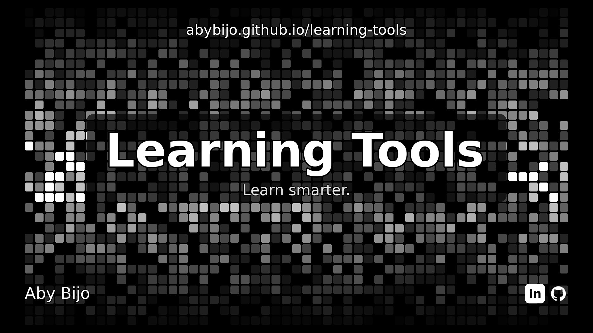

# Learning Tools



> **Learn smarter.**

Learning Tools is a growing collection of exam preparation tools, built to be the best of their kind — fast, focused, and free to use. One place for every tool an exam needs, with nothing in the way.

**Use it now: https://abybijo.github.io/learning-tools/**

## Why Learning Tools

- **No install, no account.** Every tool is a single page you open in a browser — on your phone or your computer — and start using straight away.
- **Your data stays yours.** Everything you save is stored in your own browser. Nothing is uploaded, and nothing leaves your device.
- **One job, done properly.** Each tool does a single thing and does it well, instead of doing many things badly.
- **Built for real exams.** Real exam rules, real exam pressure — timers that cannot be paused, papers beside the clock, and study plans that survive a reload.

## The tools

| Tool | What it does |
| --- | --- |
| [**Exam Timer**](https://abybijo.github.io/learning-tools/tools/exam-timer.html) | A strict, general exam timer with your paper beside the clock. Durations: 1h 30m, 1h 45m, 2h. Once started there is no pause and no stop — closing the page does not stop it; reopening resumes the timer. Load any PDF paper and read the questions while the time stays visible at the top. |
| [**Compartmentalizer**](https://abybijo.github.io/learning-tools/tools/compartmentalizer.html) | Organise subjects into chapters and topics. Add exam time and maximum marks, drag topics to reorder them, add notes to topics, and save a chapter — or a whole subject — as a PDF. The page you are on survives a reload. |

## Coming soon

**More tools and utilities are coming soon.** New tools are added here as they are built — check back for the next one.

## How to use

1. Open https://abybijo.github.io/learning-tools/
2. Pick a tool.
3. Start working — nothing to install, nothing to sign up for.

## How the index works

The general listing page is `index.html`. It is the home page of the GitHub Pages site.

Any new file added to the `tools/` folder is also indexed inside the main page: `index.html` reads the `tools/` folder listing from GitHub and adds every `.html` file it finds to the list automatically. You do not need to edit `index.html` when you add a new tool.

To add a tool:

1. Add a single `.html` file to `tools/`.
2. Commit it to the `main` branch.
3. It will appear on https://abybijo.github.io/learning-tools/ in the tools list.

## Footer (home pages only)

Every tool's home page — and the index page — carries the same footer,
pinned to the bottom of the screen: **Aby Bijo**, with links to GitHub
(https://github.com/AbyBijo) and LinkedIn
(https://www.linkedin.com/in/aby-bijo-102359282). It stays at the bottom
while the page scrolls; it is not part of the page content. Give the page
bottom padding (64px, see `footer-snippet.html`) so the last content is
never hidden behind it, and keep any floating button above the footer.

The footer goes on the home page only. Do not put it on a tool's inner pages
(for example, not on Compartmentalizer's subject or chapter pages).

The exact snippet to copy is in `footer-snippet.html` at the repository root.
A future tool file dropped into `tools/` without that snippet will not get
the footer by itself — add the snippet to the new tool's home page.

## Structure

```
index.html              General page listing all tools (GitHub Pages home page)
tools/
  exam-timer.html       Exam Timer — the initial tool
  compartmentalizer.html
                        Compartmentalizer — subjects, chapters, topics
footer-snippet.html     Footer snippet for new tools' home pages (copy-paste)
learning-tools-banner.jpg
                        Banner image — head image of this README
README.md               This file
```

## Built by

**Aby Bijo** — [GitHub](https://github.com/AbyBijo) · [LinkedIn](https://www.linkedin.com/in/aby-bijo-102359282)
